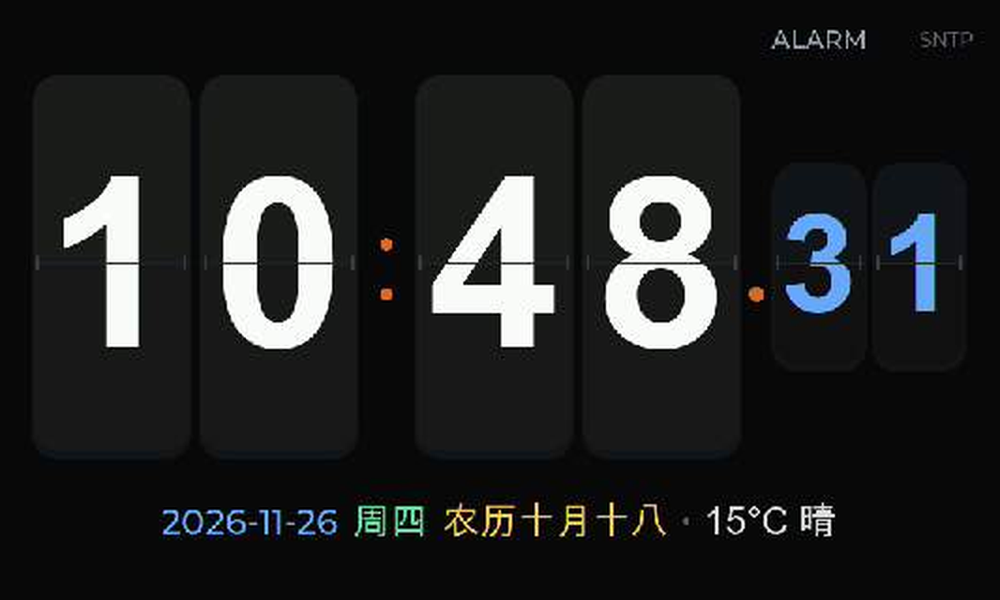
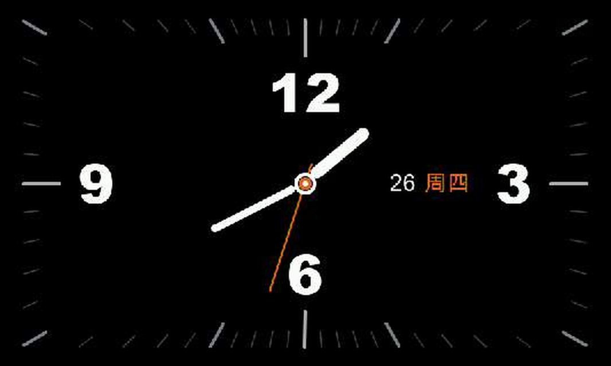
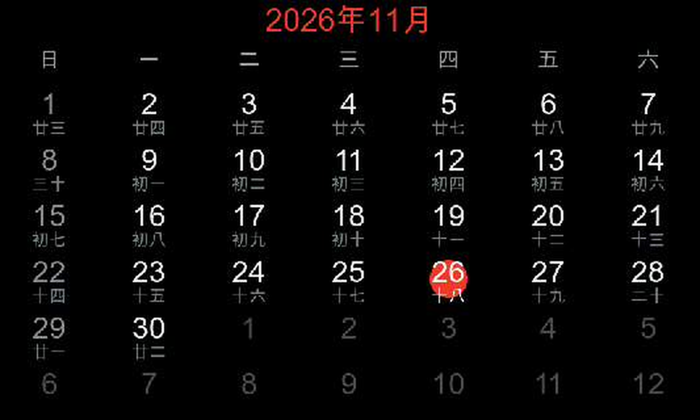
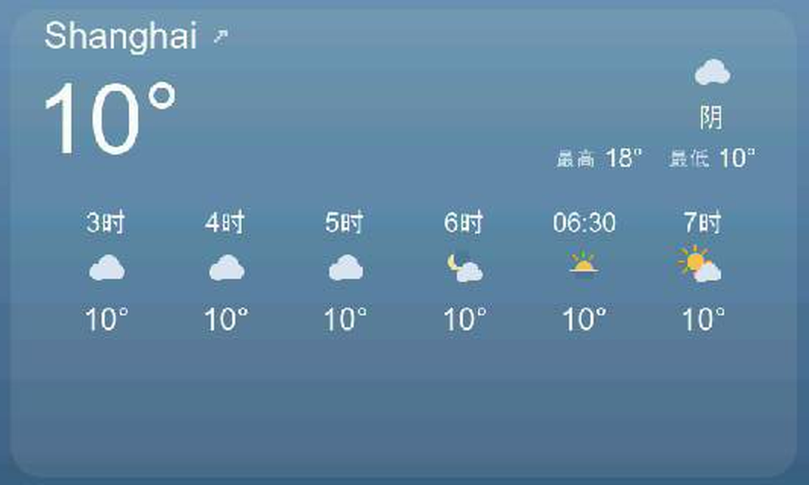
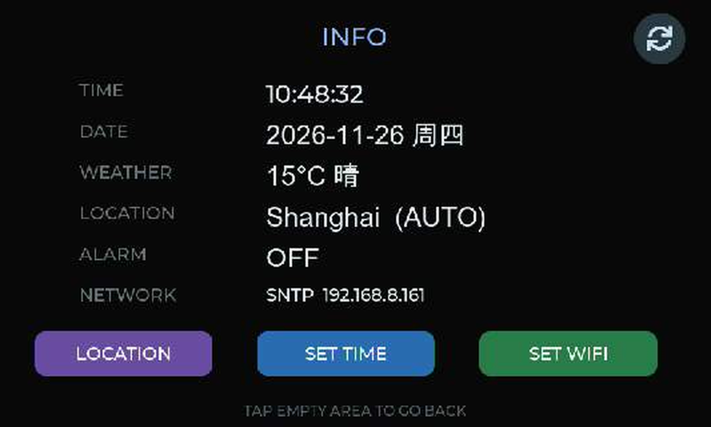
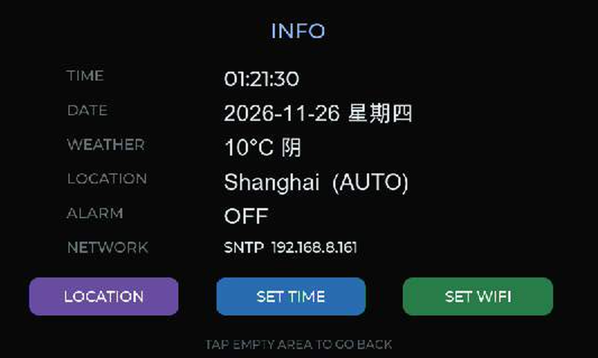
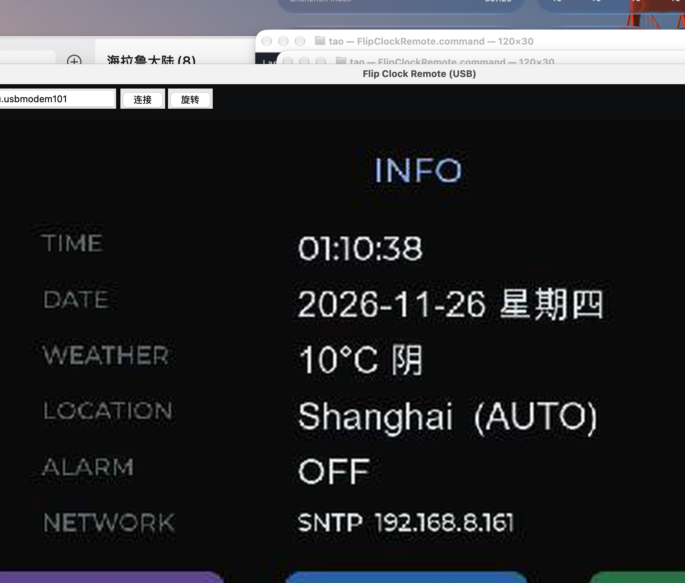

# Flip Clock (ESP32-P4 · Guition JC4880P443C)

横屏翻页时钟 + 闹钟 + 天气 + USB 遥控，跑在 ESP32-P4（4.3" 480×800，ES8311，GT911）上。

## 功能

- **翻页时钟**：800×480 横屏（软件旋转），深灰卡片、白色数字、铰链细节、上下翻页动画
- **指针表页**：长方形表盘（刻度沿边框、12/3/6/9 长刻度在外侧）、Arial Black 数字、
  细颈+粗圆头指针、白环+橙环轴心
- **日历页**：顶部居中 `2026年11月`，日/一~六表头，6×7 网格，当月数字 + 农历日，
  今天红圈；周日灰色、非本月淡出
- **天气页**：蓝底玻璃卡片；左上地区名（带定位箭头）、大号当前温度、天气图标 + 文字、
  最高/最低，按小时预报 6 格（日出按时间顺序插入）
- **页面顺序**：翻页钟 → 指针表 → 日历 → 天气 → INFO → 翻页钟（点屏幕任意处向后翻）
- **底部信息**：日期 · 星期（周X）· 农历（含闰月）· 天气；右上角 ALARM + 网络状态
- **触摸界面**：点空白进 INFO 页（时间/日期/天气/位置/闹钟/网络），可设置闹钟、手动对时、Wi-Fi 扫描配网、城市选择（35 个常用城市）
- **闹钟**：到点蜂鸣 + 全屏提示，点屏停止；设置保存到 NVS
- **联网**：ESP32-C6（esp_hosted / esp_wifi_remote）Wi-Fi + SNTP 自动对时；Open-Meteo 天气（可选按 IP 定位）
- **USB 遥控**：电脑通过 USB 串口看屏并点击控制，不依赖 Wi-Fi（Base64 分帧 JPEG，320×533 @ ~8fps）


## 截图

| 翻页钟 | 指针表 | 日历 |
|---|---|---|
|  |  |  |

| 天气 | INFO 页 | 位置选择 |
|---|---|---|
|  |  |  |

Mac 端 USB 遥控窗口（点画面 = 点屏）：



## 硬件

| 项 | 说明 |
|---|---|
| 主控 | ESP32-P4（rev 3.x，双核 400MHz，32MB PSRAM，16MB flash） |
| 屏幕 | 4.3" 480×800 ST7701S，MIPI-DSI 2 lane |
| 触摸 | GT911（I2C 0x5D，复位 GPIO3，INT 不用） |
| 音频 | ES8311 + NS4150，I2S 13/12/10/9，功放使能 GPIO11 |
| 无线 | ESP32-C6（SDIO：CLK18 CMD19 D0-3 14-17，复位 54） |

## 编译

需要 ESP-IDF **v6.0.2**：

```bash
. ~/esp/esp-idf/export.sh
idf.py set-target esp32p4
idf.py build
idf.py -p /dev/cu.usbmodem101 flash
```

## 串口命令（USB-Serial/JTAG，115200）

| 命令 | 作用 |
|---|---|
| `T<epoch>` / `t` | 设置/打印时间 |
| `A<HH:MM>` / `A0` / `A?` | 设置/取消/查看闹钟 |
| `W<ssid>,<pass>` | 设置 Wi-Fi |
| `P<lat>,<lon>` / `G` / `L` | 手动坐标 / 按 IP 定位 / 查看位置 |
| `B<0-100>` | 亮度 |
| `M1` / `M0` | 开启/关闭 USB 镜像 |
| `TAP x y` | 注入一次点击（原生 480×800 坐标） |
| `PAGE 0-4` | 直接切页：0 翻页钟 / 1 指针表 / 2 日历 / 3 天气 / 4 INFO |
| `S` | 开关 HTTP 看屏服务 |
| `R` | 面板重新同步（修复绿屏） |

## Mac 遥控工具

`tools/remote_usb.py`（需要 pyserial + Pillow）：

```bash
python3 tools/remote_usb.py /dev/cu.usbmodem101
```

## 踩坑记录

- GT911 复位脚是 **GPIO3**，且 `int_gpio_num` 必须为 -1（轮询），否则 LVGL 收不到触摸
- 整屏重绘时 `lv_draw_add_task` 崩溃 → LVGL 内存池加到 128KB、任务栈 16KB
- JPEG 编码器缓冲区必须用 `jpeg_alloc_encoder_mem` 分配（对齐）
- 串口控制台不能传二进制，镜像用 Base64 文本分帧（`#IMG` … `#END`）
- LVGL Canvas 上的文字要等真正刷屏时才取内容：`lv_draw_label` 的 `text` 必须指向
  **静态缓冲**，循环里用栈上的临时数组会出现“所有格子显示同一个值”
- 自定义 `lv_font_conv` 字模必须显式包含用到的汉字（如 `周`、`一`、`时`、`最高低`），
  否则显示成方框
- 截图直接从 DPI 帧缓冲读会干扰显示，需先下采样到私有缓冲
